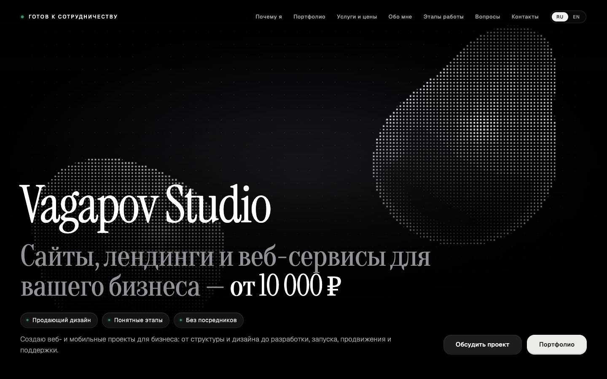

# Vagapov Studio

**Дизайн и разработка цифровых продуктов для бизнеса.**

Проектирую и создаю сайты, веб-сервисы, личные кабинеты и iOS-приложения: от структуры и интерфейса до разработки и запуска.

[Портфолио](https://vagapov-studio.netlify.app/) · [Обсудить проект](https://t.me/vagapov_studio) · [Email](mailto:vagapov.studio.pro@gmail.com)

## Выбранные проекты

| Проект | Направление |
| --- | --- |
| [Брауни](https://github.com/vagapov-studio/brownie-cafe-platform) | Сайт сети кофеен и кабинет владельца |
| [GRAPHITE](https://github.com/vagapov-studio/graphite-detailing) | Онлайн-запись для детейлинга |
| [Dent Clinic CRM](https://github.com/vagapov-studio/dent-clinic-crm) | Рабочее пространство клиники |
| [NORDEN](https://github.com/vagapov-studio/norden-retreat) | Сайт загородного ретрита |
| [Lumus](https://github.com/vagapov-studio/lumus-creative-studio) | Имиджевый сайт дизайн-студии |
| [Планировщик](https://github.com/vagapov-studio/planner-ios) | Нативное приложение для iOS |

В каждом кейсе — задача, возможности, скриншоты и ссылка на демо или экраны приложения. Исходники закрыты. Демонстрационные сценарии и готовность к запуску указаны отдельно.

[Как устроен сайт студии →](https://github.com/vagapov-studio/studio-portfolio)

## Подход

- Сначала задача бизнеса и сценарии пользователя, затем интерфейс и реализация.
- Адаптация под компьютер и телефон, внимание к деталям и понятной навигации.
- Регулярная демонстрация результата и прозрачное согласование объёма работ.

## Инструменты

HTML · CSS · JavaScript · TypeScript · React · Three.js / WebGL · Swift · SwiftUI

## Контакты

[Telegram — @vagapov_studio](https://t.me/vagapov_studio)  
[Email — vagapov.studio.pro@gmail.com](mailto:vagapov.studio.pro@gmail.com)  
[Сайт — vagapov-studio.netlify.app](https://vagapov-studio.netlify.app/)
